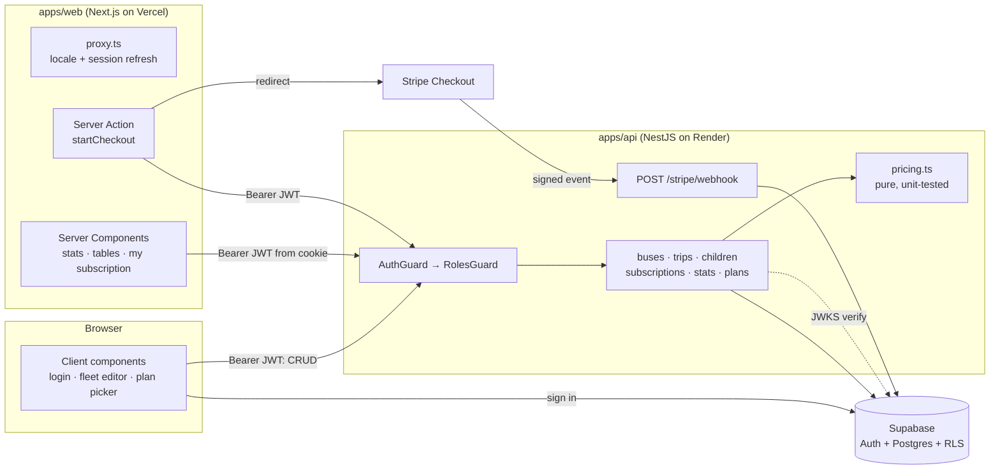

# Fleet Billing (lite)

Subscriptions and billing for a school-bus operator. Operators manage buses and trips and see revenue and seat utilization; parents pick a plan, pay through Stripe Checkout, and see their subscription become active once the webhook confirms the payment. Arabic and English, with full right-to-left support.

> **Portfolio project.** All data is synthetic (generated by `prisma/seed.ts`), Stripe runs in test mode, and no code or data comes from any employer.

- **Live demo:** _coming soon_ (web on Vercel, API on Render)
- **3-minute walkthrough (Loom):** _link to be added_
- **Demo accounts:** use the **Operator** / **Parent** buttons on the login page. Test card: `4242 4242 4242 4242`, any future date, any CVC.

## Stack

| Layer | Tech |
|---|---|
| Web | Next.js 16 App Router, React 19, TypeScript, Tailwind CSS 4, next-intl (ar/en, RTL) |
| API | NestJS 12 (ESM): modules, global guards, `class-validator` DTOs |
| Data | Prisma 7 on Supabase Postgres, Row Level Security on `subscriptions` |
| Auth | Supabase Auth; the API verifies access tokens against the project's JWKS (ES256) |
| Payments | Stripe Checkout + signed webhook (test mode) |
| Tests | Vitest (pricing, webhook, HTTP e2e), Playwright (web smoke) |
| Delivery | pnpm workspaces, GitHub Actions, Dockerfiles + docker compose, Vercel + Render |

## Architecture



**Checkout flow.** The parent submits the plan form, which calls the `startCheckout` Server Action. The API checks that the children belong to the caller, prices the order with `pricing.ts`, stores a `PENDING` subscription, and creates a Checkout Session (with an idempotency key). The browser is then redirected to Stripe. When the payment succeeds, Stripe sends `checkout.session.completed` to `/stripe/webhook`. The API verifies the signature against the raw body, checks that the charged amount matches the priced amount, and marks the subscription `ACTIVE` for one month or one term. Each event id is stored in the same transaction, so Stripe retries do nothing.

## Why Server Components here and client components there

| Piece | Kind | Why |
|---|---|---|
| Operator stats, utilization bars | Server | Read-only aggregates; zero JS shipped; streams behind its own `Suspense` |
| Subscriptions table + status filter | Server | Filter is a `?status=` link: shareable, works without JS, re-streams only that section (`Suspense key`) |
| Parent "my subscriptions", children list | Server | Fetched in parallel on the server with the session cookie |
| Plan form submit → Stripe | **Server Action** | Runs with the cookie, never exposes the amount calculation or Stripe calls to the browser, works as a plain form post, ends in `redirect()` to Stripe |
| Fleet editor (buses/trips CRUD) | Client | Inline editing needs local state and instant feedback; calls the API with the user's token, then `router.refresh()` re-renders the server parts (stats stay correct) |
| Plan picker price preview | Client | Updates as you tick children/plans; the numbers come from the API's `/plans/quote`, so pricing lives in one place |
| Login, sign-out, language switch | Client | Supabase sets the session cookie in the browser; the switch needs the current path |
| Post-payment refresh | Client | The webhook can land a second after the redirect; a tiny effect re-renders the server page until it turns active |

## Security notes

- **Identity vs. role.** The JWT proves who the caller is. The role comes from the `profiles` table, never from user-editable metadata. New sign-ups always get `PARENT`, and operators exist only through the seed.
- **RLS that is actually used.** `GET /subscriptions/mine` has no `WHERE parent_id = …`. It runs inside a transaction as the Postgres `authenticated` role, with the caller's claims set, so the policy `parent_id = auth.uid()` does the filtering. All other tables are revoked from `anon`/`authenticated`, so the Supabase Data API can't read them. The migration also creates the roles and `auth.uid()` when they're missing, so the same SQL runs on plain Postgres (docker compose, CI).
- **Webhook.** Signature verified against the raw body, idempotent per event id, and amount and currency cross-checked before activation.
- **Validation.** A global `ValidationPipe` with `whitelist` + `forbidNonWhitelisted` rejects unknown fields with 400.

## Pricing rules

`apps/api/src/pricing/pricing.ts` holds pure functions in integer cents:

- Monthly €89 per child; Term (4 months) €320 per child, about 10% below four monthly payments
- Sibling discount by child position: 2nd child −10%, 3rd and later −15%, rounded half-up
- Period end is computed in calendar months with month-end clamping (Jan 31 + 1 month = Feb 28/29)

## Running locally

Requirements: Node 24, pnpm 10 (`corepack enable`), a Supabase project, and a Stripe account in test mode.

```bash
cp .env.example .env.local          # fill in your keys
pnpm install
pnpm db:migrate                     # Prisma migrations incl. RLS
pnpm db:seed                        # synthetic data + demo login users
pnpm dev                            # api :4000, web :3000
```

Forward Stripe events to the API in a second terminal:

```bash
stripe listen --events checkout.session.completed,checkout.session.expired,checkout.session.async_payment_succeeded,checkout.session.async_payment_failed --forward-to localhost:4000/stripe/webhook
```

### With Docker

```bash
docker compose --env-file .env.local up --build
```

This runs Postgres, migrations and seed, the API, and the web app. The database is local; login and payments still go to your Supabase and Stripe test projects.

## Tests

```bash
pnpm --filter @fleet/api test       # Vitest: pricing, webhook service, HTTP e2e (no DB needed)
pnpm --filter @fleet/web build && pnpm --filter @fleet/web test:e2e   # Playwright
```

CI (`.github/workflows/ci.yml`) runs lint, typecheck, Vitest, migrations and seed on a Postgres service, the web build, Playwright, and a full `docker compose` build with smoke checks.

## Deployment

- **API on Render:** `render.yaml` blueprint (Docker). It applies migrations on start, and secrets are set in the dashboard. Add a Stripe webhook endpoint at `https://<api>/stripe/webhook` and put its secret in `STRIPE_WEBHOOK_SECRET`.
- **Web on Vercel:** root directory `apps/web`. Set `NEXT_PUBLIC_SUPABASE_URL`, `NEXT_PUBLIC_SUPABASE_PUBLISHABLE_KEY`, `NEXT_PUBLIC_API_URL`, and optionally `NEXT_PUBLIC_DEMO_PASSWORD`.
- On the API, set `WEB_URL` to the Vercel URL (used for CORS and Stripe redirects).

## Scope and trade-offs

- **Prepaid periods, not Stripe Subscriptions.** Checkout runs in `payment` mode for one month or one term, which keeps all pricing (including sibling discounts) in tested code. Auto-renewal through Stripe Billing and the Customer Portal are left out on purpose.
- **Two product pages** (operator, parent) plus login. No Storybook.
- **API image keeps dev tooling** (Prisma CLI, tsx) so the same image can migrate and seed. A size-optimized image would use `pnpm deploy --prod`.
- The demo password is public on purpose, so reviewers can log in with one click. Re-running the seed resets the data.

## Project layout

```
apps/
  api/   NestJS: src/{auth,buses,trips,children,subscriptions,stripe,stats,plans,pricing}
         prisma/{schema.prisma,migrations,seed.ts}  test/ (HTTP e2e)
  web/   Next.js: src/app/[locale]/{page,operator,parent}  src/proxy.ts  messages/{ar,en}.json  e2e/
```
